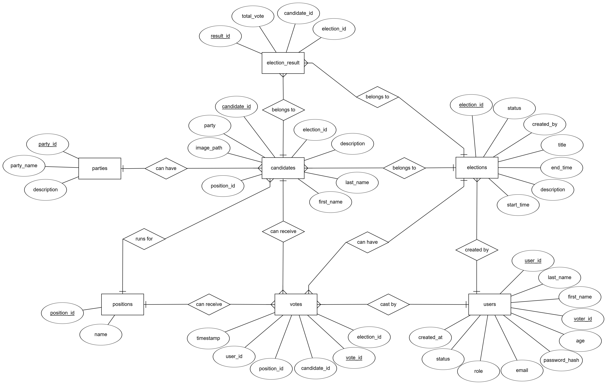
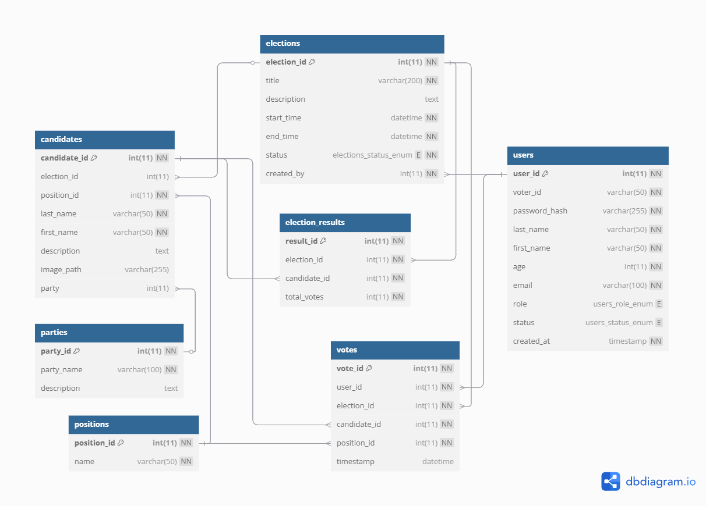

<div align="center">

<h1>SK Online Voting System</h1>

<p><b>A Web-Based Election Management and Voting System</b></p>

<p>
  A web-based voting application designed to digitalize youth council election processes through voter registration, account verification, election management, electronic ballots, and results visualization.
</p>

<p>
  Developed using Flask, Python, and MySQL to explore full-stack web development, relational database design, user authentication, and role-based election workflows.
</p>

<p>
  
  
  
  
  
  
  
</p>

<p>
  <a href="https://github.com/johncarlonas/SK-Online-Voting-System">Source Code</a>
</p>

</div>

---

## Overview

**SK Online Voting System** is a web-based election management application developed to explore the digitalization of youth council voting processes.

The system provides separate interfaces for voters and administrators, supporting account registration, voter verification, election scheduling, candidate management, electronic voting, and election results.

It uses Flask as the backend framework and MySQL or MariaDB for storing application records.

The project demonstrates how relational databases, server-side application logic, session-based authentication, and web interfaces can be integrated into an election management system.

## System Features

### Voter Functionality

| Feature | Description |
| --- | --- |
| Account Registration | Allows voters to register using personal information, a voter ID, an email address, and a password. |
| User Authentication | Supports logging in using a registered email address or voter ID. |
| Account Verification | Newly registered voters enter a pending verification state. |
| Election Dashboard | Displays election events and relevant scheduling information. |
| Candidate Directory | Organizes candidate information by electoral position. |
| Electronic Ballot | Provides position-based voting forms for chairperson, treasurer, and councilor candidates. |
| One-Time Voting Checks | Checks existing voting records to prevent repeat ballot submissions. |
| Abstention Option | Includes abstention entries within candidate selections. |
| Election Results | Displays results according to administrator-defined visibility settings. |
| Profile Management | Allows users to update supported profile information. |

### Administrator Functionality

| Feature | Description |
| --- | --- |
| Administrative Dashboard | Provides access to election management functionality. |
| Election Management | Allows creation, modification, and deletion of election events. |
| Election Scheduling | Tracks upcoming, ongoing, and ended election periods. |
| Candidate Management | Supports adding, editing, and removing candidate records. |
| Party Management | Organizes candidates into political parties. |
| Voter Verification | Allows administrators to review pending registrations. |
| Account Administration | Supports verification, rejection, and deletion of voter accounts. |
| Vote History | Displays voter participation records and timestamps. |
| Election Results | Provides vote count visualization using charts. |
| Result Visibility | Allows administrators to control public result visibility by position. |
| Profile Management | Supports administrator profile updates. |

## Technology Stack

| Component | Technology | Purpose |
| --- | --- | --- |
| Backend | Python | Application logic and database operations |
| Web Framework | Flask | HTTP routing, templates, and request handling |
| Database | MySQL / MariaDB | Persistent storage of election and user records |
| Database Connector | mysql-connector-python | SQL queries and database communication |
| Authentication | Flask Sessions | Session-based user access |
| Password Handling | bcrypt | Password hashing and verification |
| Configuration | python-dotenv | Loading environment variables |
| Frontend | HTML5 | Application page structure |
| Styling | CSS3 | User interface design |
| Client-Side Logic | JavaScript | Form validation and interactive controls |
| Visualization | Chart.js | Election result charts |
| Template Engine | Jinja2 | Rendering dynamic data in HTML templates |

## Application Modules

### Authentication and Registration

The authentication module handles user registration and login.

Users can sign in using their voter ID or registered email address.

Registration records include personal information, login credentials, an assigned role, and a verification status.

The application uses session data to identify authenticated users and provide the corresponding voter or administrator interface.

### Voter Verification

Newly registered users are assigned a pending status.

The administrator interface provides tools for reviewing registrations and managing voter account verification.

Account statuses are represented using values such as:

- `pending`
- `verified`
- `rejected`

### Election Management

Administrators can create election events with scheduled start and end dates.

The application determines election status based on the current date and time.

| Status | Description |
| --- | --- |
| Upcoming | The election has not reached its scheduled starting time. |
| Ongoing | The current time falls within the election period. |
| Ended | The scheduled election period has passed. |

### Candidate Management

The candidate management module organizes candidates according to electoral positions.

The project includes the following positions:

| Position | Ballot Selection |
| --- | --- |
| SK Chairperson | One candidate |
| SK Treasurer | One candidate |
| SK Councilor / Kagawad | Up to seven candidates |

Candidate records include names, descriptions, party affiliations, and associated positions.

The application also supports abstention entries.

### Electronic Voting

The voting interface presents candidates grouped according to their positions.

Voters select candidates through radio buttons and checkboxes.

The application validates required selections and checks existing voting records for the active election.

Submitted choices are recorded in the relational database.

### Election Results

The administrator dashboard provides election result visualization through Chart.js.

Results are organized by electoral position, with corresponding candidate names and vote counts.

The system also includes controls for managing whether position-specific results are visible to voters.

### Vote History

The vote history module provides administrators with participation records.

It retrieves voter identifiers and voting timestamps to support election activity monitoring.

## Database Structure

The application uses a relational database named:

`cccs105`

The database schema is located at:

`backend/schema.sql`

### Main Tables

| Table | Purpose |
| --- | --- |
| `users` | Stores voter and administrator account information. |
| `elections` | Stores election events, schedules, and statuses. |
| `candidates` | Stores candidate profiles and electoral position references. |
| `parties` | Stores political party information. |
| `positions` | Defines available electoral positions. |
| `votes` | Records individual candidate selections. |
| `election_results` | Stores election result records and aggregate fields. |

The application also references a `result_visibility` table for administrator-controlled result display.

### Database Relationships

The relational structure connects users, elections, positions, candidates, political parties, and voting records through their respective identifiers.

The repository includes database design diagrams.

<div align="center">

<h3>Entity Relationship Diagram</h3>



<h3>Relational Model</h3>



</div>

## Project Structure

```text
SK-Online-Voting-System/
├── .vscode/
│   └── settings.json
├── backend/
│   ├── erd.png
│   ├── rm.png
│   └── schema.sql
├── static/
│   ├── css_files/
│   │   ├── add_candidate.css
│   │   ├── add_election.css
│   │   ├── admin_home.css
│   │   ├── admin_navbar.css
│   │   ├── admin_result.css
│   │   ├── edit_candidate.css
│   │   ├── edit_election.css
│   │   ├── edit_profile.css
│   │   ├── login_page.css
│   │   ├── manage_candidates.css
│   │   ├── profile.css
│   │   ├── user_candidate_details.css
│   │   ├── user_home.css
│   │   ├── user_navbar.css
│   │   ├── user_pending.css
│   │   ├── user_result.css
│   │   ├── verify_user.css
│   │   ├── vote.css
│   │   ├── vote_history.css
│   │   └── vote_success.css
│   └── images/
│       ├── check_icon.png
│       ├── edit_icon.png
│       ├── logout_icon.png
│       ├── prof_icon.png
│       └── sk_logo.png
├── templates/
│   ├── admin/
│   │   ├── add_candidate.html
│   │   ├── add_election.html
│   │   ├── admin_edit_profile.html
│   │   ├── admin_home.html
│   │   ├── admin_navbar.html
│   │   ├── admin_profile.html
│   │   ├── admin_result.html
│   │   ├── edit_candidate.html
│   │   ├── edit_election.html
│   │   ├── manage_candidates.html
│   │   ├── verify_user.html
│   │   └── vote_history.html
│   ├── user/
│   │   ├── user_candidate_details.html
│   │   ├── user_edit_profile.html
│   │   ├── user_home.html
│   │   ├── user_navbar.html
│   │   ├── user_pending.html
│   │   ├── user_profile.html
│   │   ├── user_result.html
│   │   ├── vote.html
│   │   └── vote_success.html
│   └── login.html
├── .gitignore
├── app.py
└── README.md
```

### Directory Descriptions

- **`backend/`** contains database schema definitions and database design diagrams.
- **`static/css_files/`** contains application styling.
- **`static/images/`** contains interface icons and graphical assets.
- **`templates/admin/`** contains administrator interface templates.
- **`templates/user/`** contains voter interface templates.
- **`templates/login.html`** contains the login and registration interface.
- **`app.py`** contains Flask routes, database operations, authentication logic, and application functionality.

## Getting Started

Follow these steps to set up the application locally.

### Prerequisites

Install the following:

- [Python](https://www.python.org/downloads/)
- [Git](https://git-scm.com/downloads)
- [MySQL](https://dev.mysql.com/downloads/) or [MariaDB](https://mariadb.org/download/)
- A web browser

### 1. Clone the Repository

```bash
git clone https://github.com/johncarlonas/SK-Online-Voting-System.git
```

Navigate into the project directory:

```bash
cd SK-Online-Voting-System
```

### 2. Create a Virtual Environment

**Windows (PowerShell)**

```powershell
py -m venv .venv
.\.venv\Scripts\Activate.ps1
```

**macOS / Linux**

```bash
python3 -m venv .venv
source .venv/bin/activate
```

### 3. Install Dependencies

The repository does not currently include a `requirements.txt` file.

Install the Python packages used by the application:

```bash
python -m pip install --upgrade pip
python -m pip install flask mysql-connector-python python-dotenv bcrypt
```

### 4. Configure the Database

Start your local MySQL or MariaDB server.

The repository contains a database schema file:

`backend/schema.sql`

Import the schema using the MySQL command-line client:

```bash
mysql -u root -p < backend/schema.sql
```

Enter your database password when prompted.

The schema was exported from a MariaDB environment. Database name casing may require adjustment on case-sensitive installations.

### 5. Configure Environment Variables

Create a local `.env` file in the project root with your own development configuration.

```dotenv
DB_HOST=localhost
DB_USER=your_database_username
DB_PASSWORD=your_database_password
DB_NAME=cccs105
SECRET_KEY=your_new_random_secret_key
```

Generate a random Flask secret key using Python:

```bash
python -c "import secrets; print(secrets.token_hex(32))"
```

Use the generated value for `SECRET_KEY`.

Keep local credentials private and exclude `.env` from version control.

### 6. Run the Application

Start the Flask development server locally with the interactive debugger disabled:

```bash
python -m flask --app app run --host 127.0.0.1 --port 5000 --no-debugger --no-reload
```

Open the application in your browser:

```text
http://127.0.0.1:5000
```

The application connects to the configured database during startup.

## Application Routes

The system provides routes for authentication, election management, candidate administration, and voting.

### Authentication

| Route | Purpose |
| --- | --- |
| `/` | Redirects to the login page |
| `/login` | User authentication |
| `/register` | Voter account registration |
| `/logout` | Clears the active session |

### Administrator

| Route | Purpose |
| --- | --- |
| `/admin/home` | Election administration dashboard |
| `/admin/add_election` | Create election events |
| `/admin/manage_candidates` | View and manage candidates |
| `/admin/add_candidate` | Add candidate records |
| `/admin/results` | View election results |
| `/admin/update_visibility` | Update result visibility |
| `/admin/verify_user` | Manage voter verification |
| `/admin/vote_history` | View voting participation history |
| `/admin/profile` | View administrator profile |

### Voter

| Route | Purpose |
| --- | --- |
| `/user/home` | Voter dashboard |
| `/user/vote` | Electronic voting interface |
| `/user/vote_success` | Vote submission confirmation |
| `/user/candidates` | Candidate directory |
| `/user/results` | Election results |
| `/user/profile` | Voter profile |
| `/user/edit_profile` | Edit voter profile |

## Project Background

SK Online Voting System was developed to explore how web technologies can support election-related administrative and voting processes.

The project provided hands-on experience in developing a multi-page Flask application, organizing relational database records, implementing account authentication, managing user roles, and handling transactional data.

Through this project, I explored:

- Full-stack web application development using Flask.
- Relational database design and SQL queries.
- User registration and authentication.
- Session-based application access.
- Administrative and voter-facing interfaces.
- Election scheduling and status management.
- Candidate and party administration.
- Electronic ballot design and validation.
- Database-backed voting records.
- Dynamic election result visualization.

The project serves as an educational prototype for understanding the software components involved in an online election management system.

---

<div align="center">

**SK Online Voting System**

A Flask and MySQL-based election management project.

Developed by [John Carlo E. Nas](https://github.com/johncarlonas)

</div>
